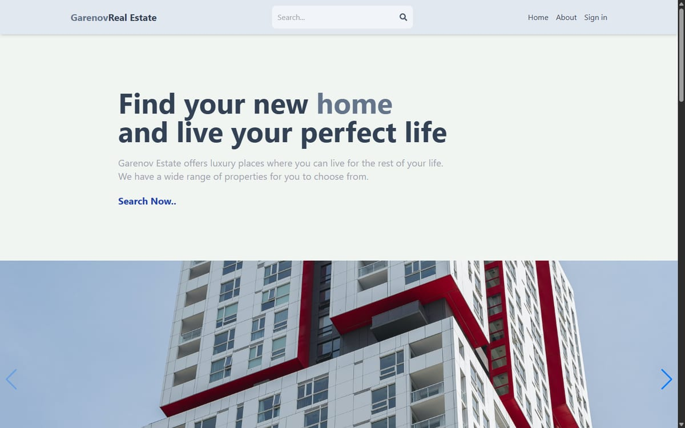
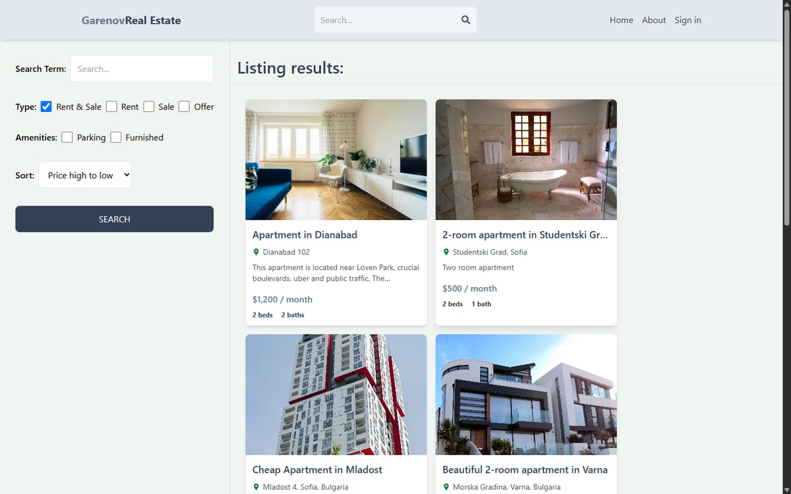
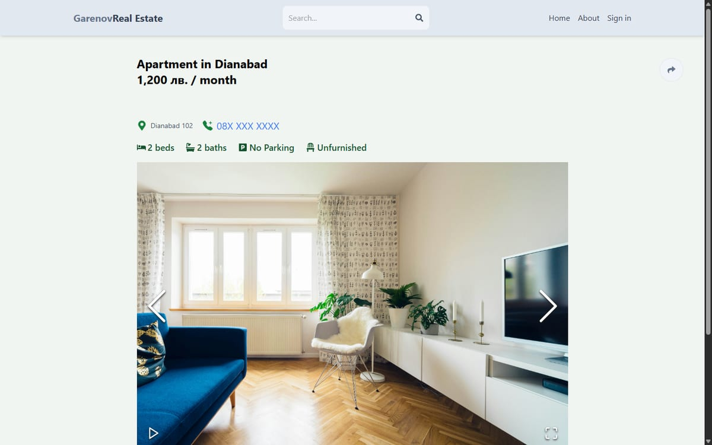
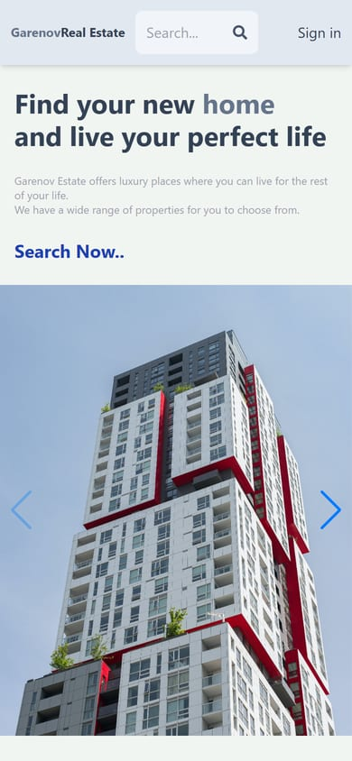
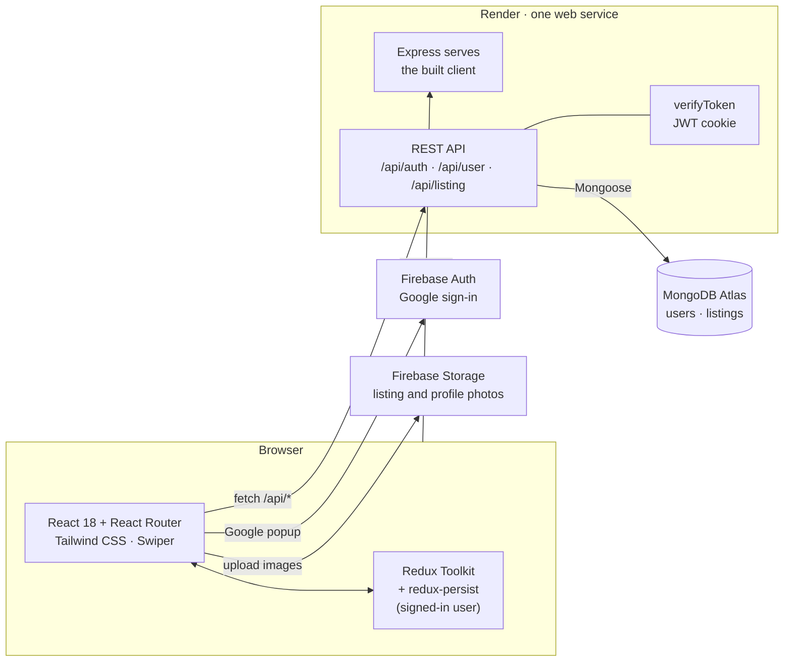
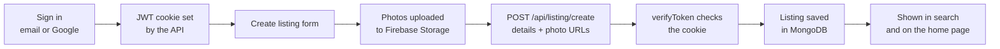

<p align="center">
  
</p>

<h1 align="center">Garenov Real Estate</h1>

<p align="center">
  A full-stack real estate marketplace built with the MERN stack: browse and filter properties for rent or sale, sign in with email or Google, and publish and manage your own listings with photos.
</p>

<p align="center">
  <a href="https://real-estate-app-mern-qxrr.onrender.com/"><b>🌐 Live demo</b></a>
</p>

> The app runs on Render's free tier. If nobody has used it for a while, the first load can take up to a minute while the server wakes up.



## Screenshots

| Search with filters | Listing page |
| --- | --- |
|  |  |

<p align="center">
  
  <br />
  <sub>Mobile layout</sub>
</p>

## Features

**Browsing**

- Home page with a photo carousel and the latest offers, rentals and sales
- Search by keyword, with filters for rent or sale, offers, parking and furnished, and sorting by price or date
- Filters live in the URL, so a search can be bookmarked or shared
- "Show more" pagination on the results
- Listing page with a photo slider, price, discount, rooms, amenities and the owner's phone number
- Contact the owner: writes an email to them with the listing name as the subject

**Accounts**

- Sign up and sign in with email and password, or with Google (Firebase Authentication)
- JWT stored in an `httpOnly` cookie, and private routes for the profile and listing pages
- Profile page: change the username, email, password and profile picture, or delete the account
- The signed-in user is kept across reloads with `redux-persist`

**Your listings**

- Create a listing with up to 6 photos, uploaded to Firebase Storage
- Edit and delete your own listings. The API checks that the listing belongs to you

## Architecture



## Creating a listing



## Tech stack

| Layer | Tools |
| --- | --- |
| Frontend | React 18, React Router 6, Redux Toolkit, redux-persist, Vite, Tailwind CSS, Swiper |
| Backend | Node.js, Express, Mongoose, JSON Web Tokens, bcrypt |
| Services | MongoDB Atlas, Firebase Authentication (Google), Firebase Storage |
| Hosting | Render (API and client from one service) |

## Project structure

```text
api/
  controllers/    # auth, user and listing handlers
  models/         # Mongoose schemas: User, Listing
  routes/         # Express routers
  utils/          # error helper, verifyToken middleware
  index.js        # app setup, database connection, serves client/dist
client/
  src/
    components/   # Header, ListingItem, Contact, OAuth, PrivateRoute
    pages/        # Home, Search, Listing, Profile, Create/UpdateListing, SignIn, SignUp, About
    redux/        # store with redux-persist, user slice
    firebase.js   # Firebase app config
```

## Running locally

You need Node.js 18+, a MongoDB database (local or Atlas) and a Firebase project with Authentication (Google provider) and Storage turned on.

```bash
git clone https://github.com/GGarenov/real-estate-app.git
cd real-estate-app

# API, from the root folder
npm install
npm run dev          # http://localhost:3000

# Client, in a second terminal
cd client
npm install
npm run dev          # http://localhost:5173, /api is proxied to port 3000
```

Create `.env` in the root folder:

```env
MONGODB=mongodb+srv://...
JWT_SECRET=...
```

Create `client/.env`:

```env
VITE_FIREBASE_API_KEY=...
```

The rest of the Firebase config is in `client/src/firebase.js`. Change it to your own project's values.

To build for production, run `npm run build` in the root folder and then `npm start`. Express serves the built client from `client/dist`.
